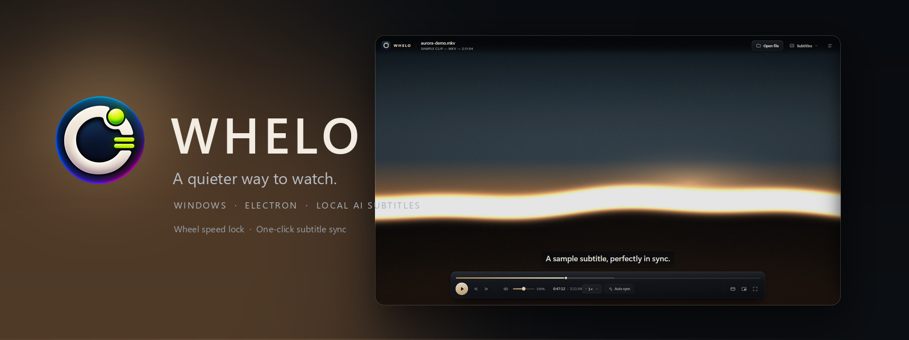
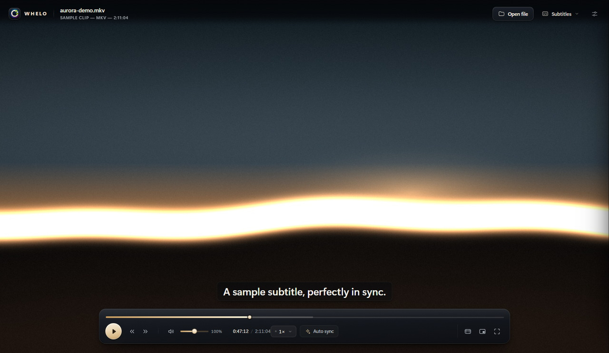
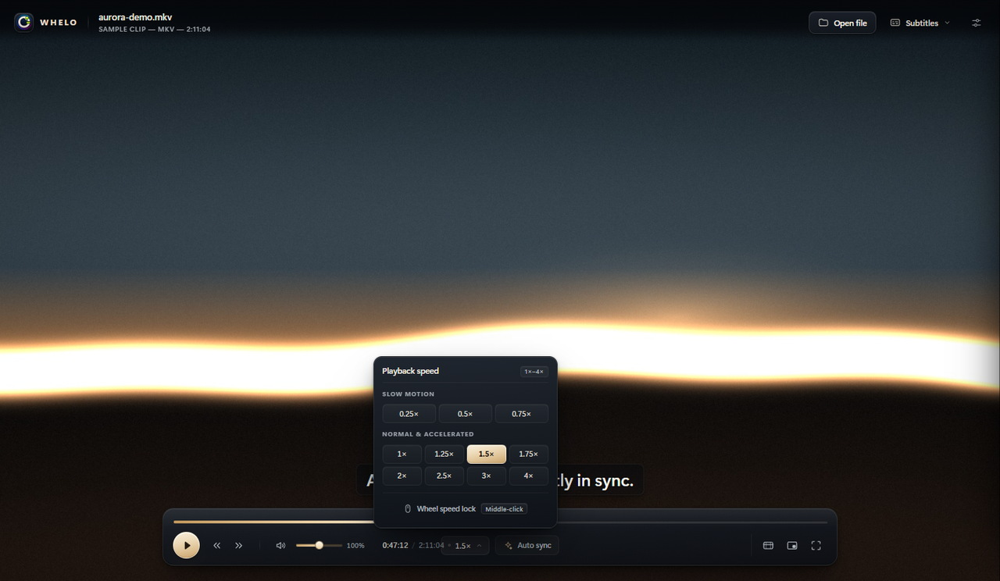
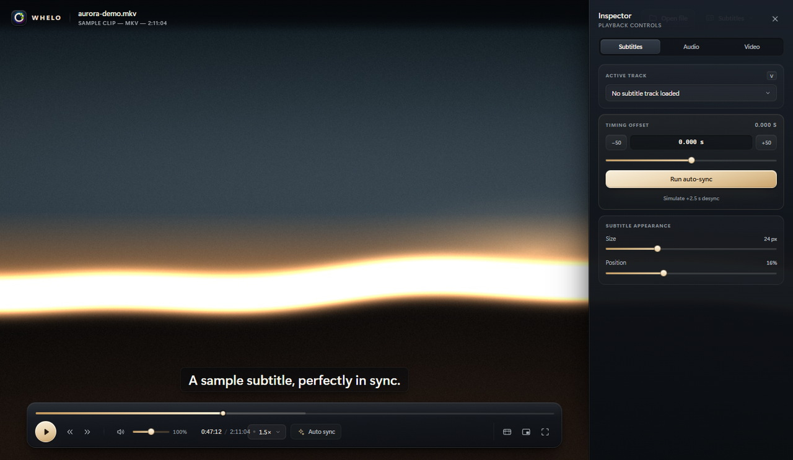
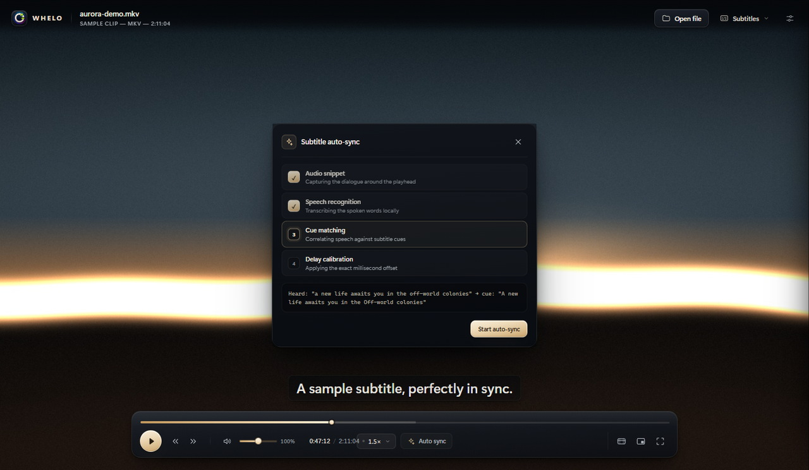
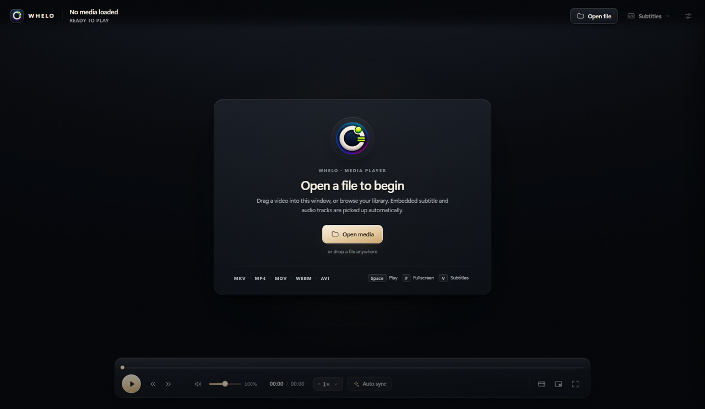
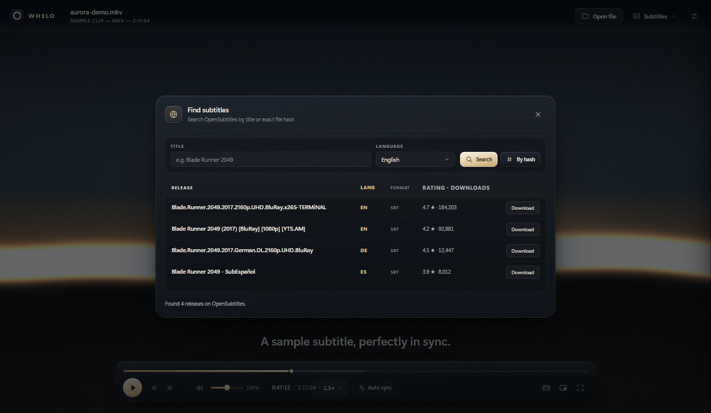
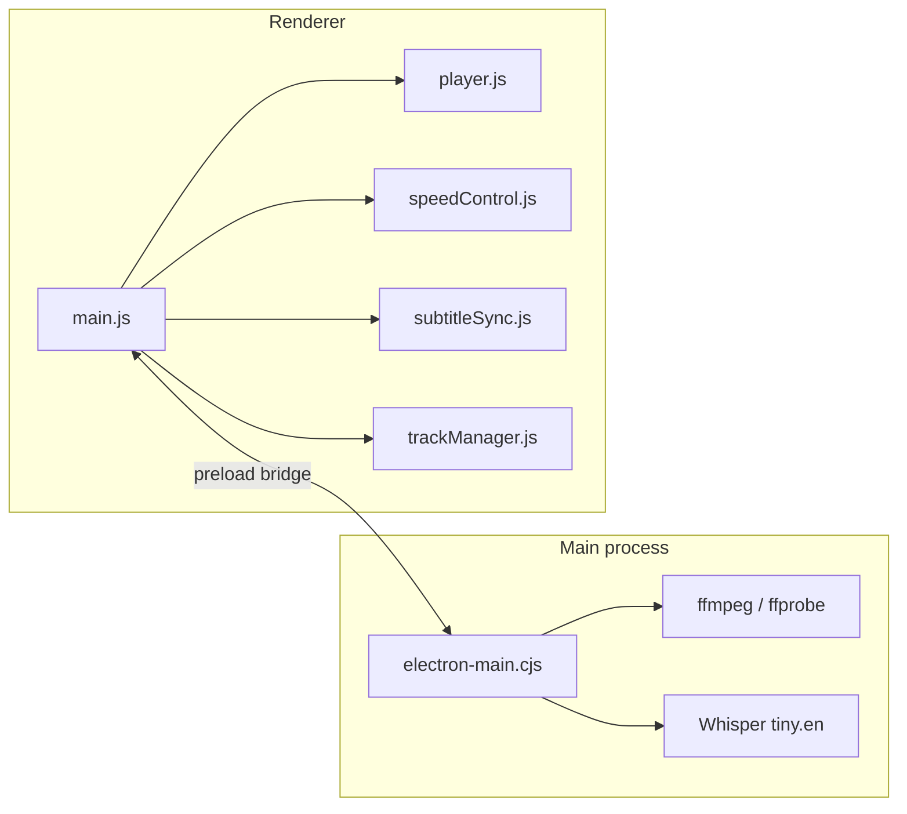

<p align="center">
  
</p>

<h3 align="center">A quiet, cinematic media player for Windows.</h3>

<p align="center">
  <a href="https://github.com/XNtriCT/whelo/actions/workflows/ci.yml"></a>
  <a href="https://github.com/XNtriCT/whelo/releases/latest"></a>
  <a href="LICENSE"></a>
  
  
</p>

WHELO is a local-first video player built for long viewing sessions. It plays what you
throw at it, keeps the picture clean, and fixes the two things that ruin a good film:
drifting subtitles and a speed control that covers the screen.

No account, no telemetry, no library to manage. Open a file and watch.

---

## Screenshots

| Playback | Speed, without the overlay |
|:--:|:--:|
|  |  |
| The dock steps back after 2.8 seconds and the subtitle plate stays legible over any frame. | Middle-click and drag for 1.0×–4.0×; the preset menu reaches 0.25×. |

| Inspector | Local subtitle sync |
|:--:|:--:|
|  |  |
| Subtitle timing, tone, video filters and track selection in one drawer. | Whisper transcribes the dialogue on your machine and matches it to the cues. |

| Welcome | Find subtitles |
|:--:|:--:|
|  |  |
| Drag a file anywhere, or browse. The chrome dims until something is loaded. | Search OpenSubtitles by title or exact file hash. |

## Features

**Playback that gets out of the way**

- Mouse-wheel speed lock: middle-click, drag horizontally, 1.0×–4.0× with pitch preserved.
- Presets from 0.25× to 4×, and `[` / `]` for fine 0.1× steps.
- A 32 px speed capsule while locking — it never covers the picture.
- 200% volume boost with a soft limiter, plus a 3-band tone equalizer.
- Centre-channel dialogue folded into stereo for quiet mixes.
- Brightness, contrast, saturation and hue in real time.
- Auto, 16:9, 4:3, 2.35:1 and fill aspect modes; picture-in-picture; frame snapshots.

**Subtitles that stay in sync**

- One-click auto-sync: an audio snippet is transcribed locally, matched against the
  cue text, and the exact millisecond offset is applied — with undo.
- SRT, WebVTT and ASS parsing, including styled and multi-line cues.
- Embedded subtitle tracks are probed from the container and extracted losslessly.
- Manual `-50 ms` / `+50 ms` stepping, a delay slider, size and position controls.
- OpenSubtitles search by title or by the 64-bit file hash, downloaded and loaded live.

**A desktop application, not a web page**

- File associations for MKV, MP4, AVI, MOV, WebM, WMV, FLV, M4V, TS and M2TS.
- Double-click a video in Explorer; a running instance takes the file instead of
  opening a second window.
- Drag and drop for media and subtitles.
- Full right-click menu: media, playback, audio, video, subtitles, tools and view.
- Every control reachable from the keyboard.

## Download

**[Download the latest release](https://github.com/XNtriCT/whelo/releases/latest)** —
`Whelo-Installer.exe` for Windows 10 and 11 (x64).

- The installer bundles the quantized Whisper model, so speech recognition is offline.
  Expect a ~226 MB download.
- **ffmpeg is required** for embedded-track probing and subtitle auto-sync. Install it
  and add it to `PATH` (or `C:\ffmpeg\bin`). Direct MP4/WebM playback works without it.
- The build is not code-signed yet, so SmartScreen may ask you to confirm:
  **More info → Run anyway**.
- Verify your download against the `SHA256SUMS.txt` attached to each release.

## Tech stack

| Layer | Choice |
| --- | --- |
| Shell | Electron 45 (Chromium + Node) |
| Build | Vite 8, electron-builder 26, NSIS |
| UI | Hand-written HTML, CSS and ES modules — no framework |
| Speech | Transformers.js 2.17 + ONNX Runtime, `Xenova/whisper-tiny.en` (quantized) |
| Media | ffmpeg / ffprobe for probing, demuxing and audio extraction |
| Subtitles | Custom SRT / VTT / ASS parser, OpenSubtitles REST API |

## Architecture



The renderer owns presentation and playback state; the main process owns the
filesystem, media binaries, speech recognition and HTTP. The preload bridge is the
only connection between them.

Deeper detail — IPC channels, subtitle pipeline, design tokens and the build graph —
lives in [docs/ARCHITECTURE.md](docs/ARCHITECTURE.md).

## Getting started

**Requirements:** Windows 10/11, Node.js 20+, and ffmpeg on `PATH` (or in
`C:\ffmpeg\bin`). ffmpeg is what makes embedded-track probing, subtitle extraction
and audio sampling work; the player itself is plain Chromium.

```bash
git clone https://github.com/XNtriCT/whelo.git
cd whelo
npm ci
npm run models          # fetch the 41 MB Whisper model, once
```

Run the desktop app:

```bash
npm run build
npm run electron:start
```

Preview the interface in a browser (native dialogs and track probing disabled):

```bash
npm run dev
```

Build the installer:

```bash
npm run models
npm run dist:installer   # release/WHELO Media Player Setup <version>.exe
```

## Usage

| Action | Shortcut |
| --- | --- |
| Play / pause | `Space` |
| Seek 5 s / 10 s / 30 s | `←` `→` · `Shift` · `Ctrl` |
| Volume | `↑` `↓`, mute with `M` |
| Speed lock (1.0×–4.0×) | Middle-click, then drag horizontally |
| Speed fine step / reset | `[` `]` · `=` |
| Fullscreen / picture-in-picture | `F` · `P` |
| Subtitle delay earlier / later | `G` · `H` |
| Cycle subtitle / audio track | `V` · `B` (add `Shift` to reverse) |
| Snapshot | `Shift + S` |
| Context menu | Right-click |

## Configuration

WHELO keeps no profile and writes no settings; preferences reset each session.

- **ffmpeg** is discovered in this order: `C:\ffmpeg\bin`, the packaged
  `resources/bin`, the app directory, then `PATH`.
- **Models** live in `models/Xenova/whisper-tiny.en` during development and in
  `resources/models` once packaged. Remote model loading is disabled.
- **Network** is used only when you explicitly search OpenSubtitles. Speech
  recognition never leaves the machine.

## Roadmap

- Code-signed installer and automatic updates.
- macOS and Linux builds.
- Persistent preferences and resume points.
- A lightweight library view for folders and series.
- Per-track audio delay for badly mastered discs.
- End-to-end playback tests in CI.

Ideas and votes are welcome in [Discussions](https://github.com/XNtriCT/whelo/discussions)
or as a feature request issue.

## Contributing

Bug reports, fixes and focused features are welcome. Read
[CONTRIBUTING.md](CONTRIBUTING.md) first — it covers setup, the DOM contract that keeps
playback working, and the no-emoji, offline, token-driven design rules.

```bash
npm run verify   # syntax, unit tests, contract tests, production build
```

This project follows the [Contributor Covenant](CODE_OF_CONDUCT.md).

## Security

WHELO ships no telemetry and stores no credentials. To report a vulnerability, use
GitHub's private advisory flow — see [SECURITY.md](SECURITY.md). Please do not open a
public issue for security problems.

## License

[MIT](LICENSE) © 2026 XNtriCT

WHELO is an independent project. It is not affiliated with or endorsed by the VideoLAN
project; VLC is referenced only as a behavioural benchmark for desktop playback.
