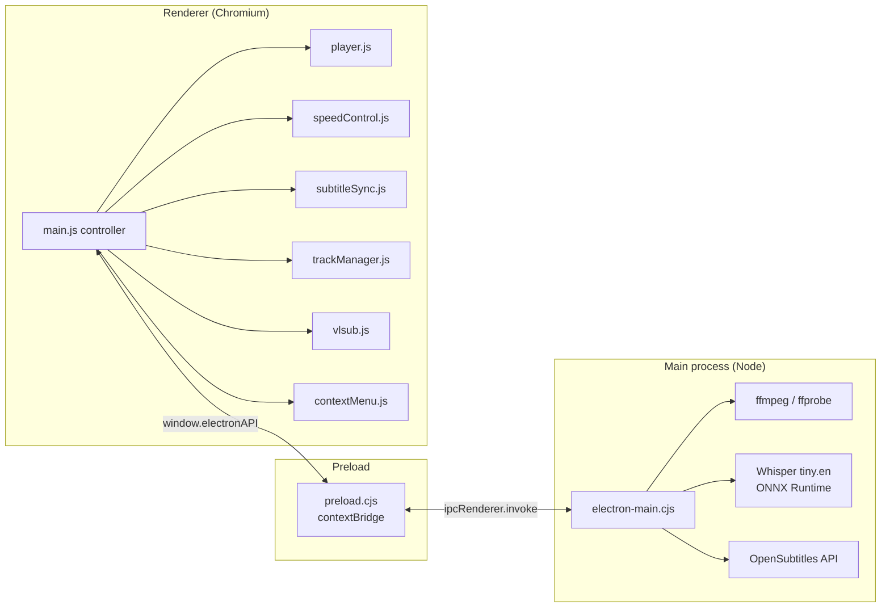
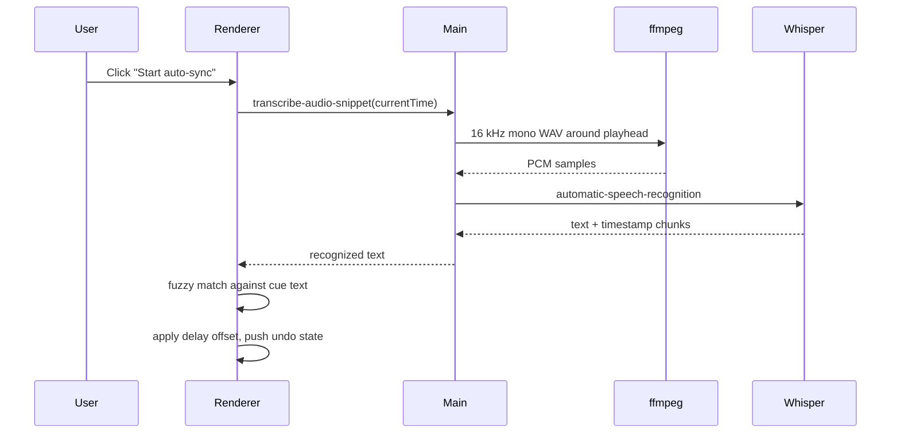
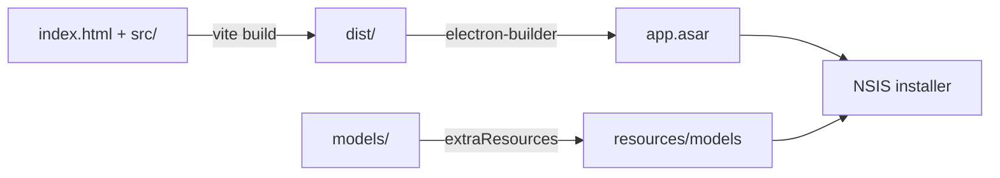

# Architecture

WHELO is a small Electron application with a deliberately thin main process and a
single renderer that owns presentation and playback state.

## Process model

| Layer | Responsibility |
| --- | --- |
| Main | Window lifecycle, native dialogs, file probing, media extraction, speech-to-text, HTTP calls, single-instance handling |
| Preload | The only bridge. Exposes a fixed, promise-based API; no Node access in the renderer |
| Renderer | Playback, subtitles, track switching, speed, context menu, inspector and all styling |

The renderer never touches the filesystem. It receives either `file://` URLs chosen
through native dialogs, or subtitle text returned by IPC.

## IPC surface

| Channel | Direction | Purpose |
| --- | --- | --- |
| `app:get-initial-file` | renderer → main | File passed on the command line (Explorer double-click) |
| `dialog:open-video` | renderer → main | Native video picker |
| `dialog:open-subtitle` | renderer → main | Native subtitle picker, returns text |
| `media:probe` | renderer → main | ffprobe stream inventory (audio + subtitle tracks) |
| `media:extract-subtitle` | renderer → main | Convert an embedded subtitle stream to WebVTT |
| `media:extract-audio` | renderer → main | Demux a secondary audio track for playback |
| `media:transcribe-audio-snippet` | renderer → main | ffmpeg 16 kHz mono sample → Whisper transcription |
| `media:movie-hash` | renderer → main | OpenSubtitles 64-bit file hash |
| `vlsub:search` / `vlsub:download` | renderer → main | OpenSubtitles search and subtitle download |
| `app:open-file` | main → renderer | A second instance forwards its file to the open window |

## Subtitle pipeline

All inference is local. The model is loaded from `models/Xenova/whisper-tiny.en`
(development) or `resources/models/...` (packaged), with remote model loading disabled.

## Renderer modules

- `main.js` — DOM lookups, event wiring, OSD/toasts, the only module that knows about
  every subsystem. Subsystems report state through callbacks.
- `player.js` — HTML5 video plus a Web Audio graph: gain, limiter, 3-band EQ and a
  channel mixer that folds centre/surround into stereo for the 200% boost.
- `speedControl.js` — pointer-lock style horizontal wheel gesture, clamped to 1x–4x;
  presets live in the UI and reach 0.25x.
- `subtitleSync.js` — SRT/VTT/ASS parsing, delay arithmetic with undo history, and the
  word-matching auto-sync algorithm.
- `trackManager.js` — merges embedded tracks from ffprobe with user-added subtitles.
- `vlsub.js` — OpenSubtitles search and download through the main process.
- `contextMenu.js` — builds a nested desktop menu and dispatches one action object.
- `ui.js` — presentation only: paints range-input fills and mirrors popover state.

## Design system

`src/style.css` is the single source of truth. Tokens live in `:root`:

- ink scale `--ink-000` … `--ink-400` (cool, hue-shifted graphite);
- warm light `--cream`, `--brass-1` … `--brass-4`;
- surfaces as multi-stop gradients, never flat fills;
- depth via `--lift-1` … `--lift-4` plus 1 px inner catch-lights;
- geometry `--r-xs` … `--r-2xl`, motion `--ease`, `--fast`, `--base`.

The renderer is offline by design: system font stack, inline SVG icons, no CDN.

## Build and packaging

`electron-builder` produces a per-user NSIS installer with file associations for
MKV, MP4, AVI, MOV, WebM, WMV, FLV, M4V, TS and M2TS.

## Testing strategy

- `tests/subtitles.test.js` exercises the parser, delay arithmetic and cue lookup.
- `tests/contracts.test.js` protects the renderer contract: every ID the JavaScript
  queries must exist, the design tokens must be present, no emoji may creep back in,
  and the build inputs must exist.

Visual states are reviewed with a small Electron harness (not shipped) that loads
`dist/` and captures the empty, playback, speed, inspector, auto-sync and subtitle
states for comparison.
